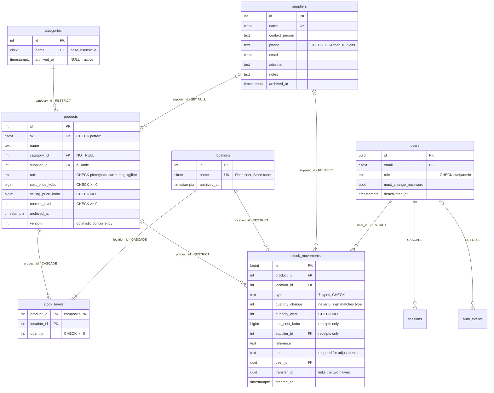
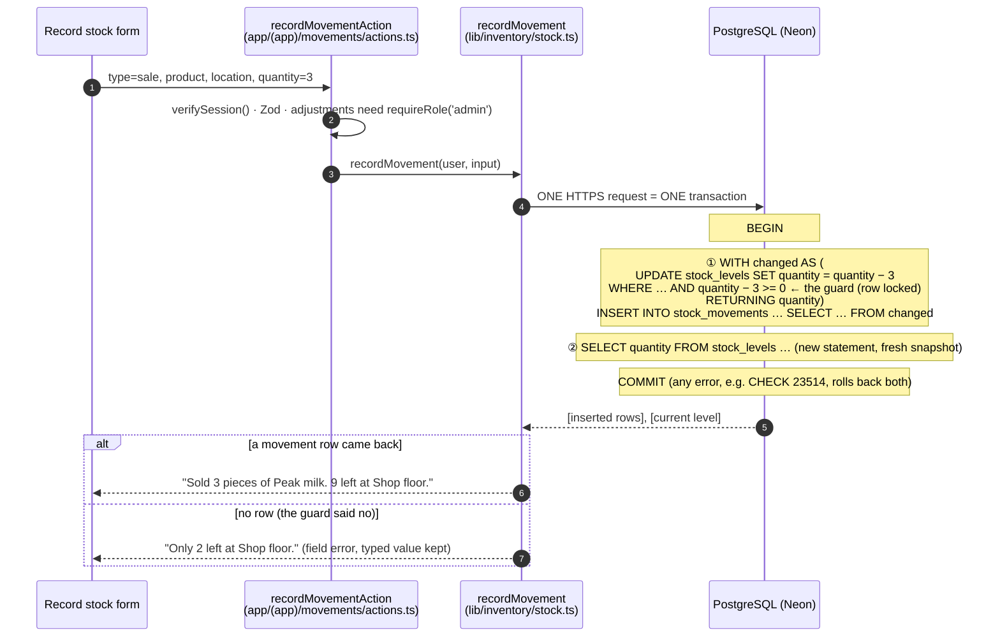

# Ìpamọ́: stock kept safe

**Ìpamọ́** (Yoruba for "keeping safe", as in storing goods) is a stock manager for a small Nigerian shop. The demo data is *Mama Ngozi Provisions* in Wuse 2, Abuja: two locations (the shop floor and the store room), four distributors and 42 everyday products, from Peak milk to Mama Gold rice.

Staff record the goods that come in from suppliers, sales, damaged or expired goods, customer returns, and transfers between the two locations. The owner sees:

- what is running low
- what the stock is worth, at cost and at selling price
- every change that was made, and by whom

Day 18 of a 30-day build challenge. **Learning focus: CRUD with PostgreSQL.**

- A schema of several tables, with a deliberate `ON DELETE` rule on every foreign key.
- Full create, read, update and delete, with **archive instead of delete** wherever history depends on a row.
- **Stock that is always correct:** every change is one transaction, and the level can never go below zero, even when two people sell the last tin at the same moment.

Stack: Next.js 16.4 (App Router, Cache Components), TypeScript (strict), Tailwind CSS v4, PostgreSQL on Neon with plain parameterised SQL, and Zod. There is no ORM and no UI, form, table or auth library. Auth is the hand-built system from Day 17.

---

## Contents

- [Run it locally](#run-it-locally)
- [Deploy to Vercel](#deploy-to-vercel)
- [The database](#the-database)
- [Delete rules](#delete-rules)
- [One stock movement = one transaction](#one-stock-movement--one-transaction)
- [Why a ledger beats editing a number](#why-a-ledger-beats-editing-a-number)
- [EXPLAIN: search and low stock](#explain-search-and-low-stock)
- [Who can do what](#who-can-do-what)
- [What changed when reusing the Day 17 auth](#what-changed-when-reusing-the-day-17-auth)
- [Design](#design)
- [Concepts and where they live](#concepts-and-where-they-live)
- [Things learned along the way](#things-learned-along-the-way)
- [Not built (yet)](#not-built-yet)

---

## Run it locally

You need Node 22.18 or newer and a free [Neon](https://neon.tech) project.

1. **Install:** `npm install`
2. **Environment:** copy `.env.example` to `.env.local` and fill it in:
   - `DATABASE_URL`: the **pooled** connection string (Neon → your project → Connect → "Connection pooling" on; the host contains `-pooler`).
   - `DATABASE_URL_UNPOOLED` (optional): the direct string. Migrations prefer it.
   - `SEED_ADMIN_PASSWORD` and `SEED_STAFF_PASSWORD`: any passwords of 8 to 128 characters for the two demo accounts.
   - `RESEND_API_KEY` (optional): without it, emails (verification and password-reset links) are printed in the terminal.
3. **Create the tables:** `npm run db:migrate`. Run it again any time; with nothing new it does nothing.
4. **Add the demo shop:** `npm run db:seed`. It's safe to run twice: the second run changes nothing.
5. **Start:** `npm run dev`, then open <http://localhost:3000>.

Sign in as `admin@example.com` (admin) or `staff@example.com` (staff), with the passwords from your `.env.local`.

| Script | What it does |
| --- | --- |
| `npm run db:migrate` | Applies new files in `db/migrations/` in order, each in its own transaction, recorded in `schema_migrations` |
| `npm run db:seed` | Accounts, locations, categories, suppliers, 42 products and four weeks of simulated stock history (only into an empty ledger) |
| `npm run db:explain` | Query plans for the search and low-stock queries on 20,000 rolled-back test products |
| `npm run check:contrast` | Checks 38 colour pairs in both themes against WCAG AA |
| `npm run typecheck` | Regenerates route types, then `tsc --noEmit` |

## Deploy to Vercel

1. Push the repository to GitHub and import it in Vercel. The framework is detected automatically.
2. Add the environment variables below in **Settings → Environment Variables**.
3. Run the migrations and the seed against the production database once, from your machine: put its URL in `.env.local`, then run `npm run db:migrate` and `npm run db:seed`.

| Variable | Required | Value |
| --- | --- | --- |
| `DATABASE_URL` | yes | Neon **pooled** connection string |
| `DATABASE_URL_UNPOOLED` | no | Neon direct connection string (only the migrate script uses it) |
| `APP_URL` | yes | The site's address, e.g. `https://ipamo.vercel.app`, no trailing slash. Email links are built from it, never from the request's Host header |
| `RESEND_API_KEY` | no | A Resend key. Without it, emails go to the function logs |
| `EMAIL_FROM` | with Resend | e.g. `Ìpamọ́ <stock@yourdomain.ng>` (a domain verified in Resend) |
| `SEED_ADMIN_PASSWORD` | for the seed | Demo admin password |
| `SEED_STAFF_PASSWORD` | for the seed | Demo staff password |

---

## The database

Plain SQL in numbered migrations:

- `001`–`005` are Day 17's auth tables, copied unchanged.
- `006` turns users into shop staff.
- `007`–`011` are the inventory.
- `012` is a fix (see [Things learned](#things-learned-along-the-way)).

**Every table, column, constraint and index has a comment in its migration saying why it exists.**



| Table | Why it exists | Key decisions |
| --- | --- | --- |
| `categories` | Shelves for grouping products | `citext` + `UNIQUE`, so "Drinks" and "drinks" can't both exist; archived rather than deleted when in use |
| `suppliers` | Who we buy from | Phone stored ONE way, as E.164 `+234…` (a CHECK enforces it); accepted as `0803 123 4567`, `+234 803…` and so on |
| `locations` | Where stock is | Seeded in the migration, because nothing works without at least one |
| `products` | What we keep | Money is integer **kobo** in `bigint`; `version` for optimistic concurrency; indexes on both foreign keys |
| `stock_levels` | How many are at each location **now** | Composite primary key `(product_id, location_id)`; `CHECK (quantity >= 0)` as the safety net; triggers give every product a row at every location |
| `stock_movements` | The ledger: why every number is what it is | Append-only (a trigger refuses UPDATE, DELETE and TRUNCATE); CHECKs tie the sign, cost, supplier and transfer id to the type |

**Indexes, one per real query:**

- Trigram GIN indexes on `products.name` and `products.sku::text` for `ILIKE '%…%'` search.
- `products(category_id)` and `products(supplier_id)`. Postgres doesn't index the referencing side of a foreign key itself, and both filters and delete checks need these.
- A partial index of active products by name.
- `stock_levels(location_id)`.
- On the ledger:
  - `(product_id, created_at DESC, id DESC)` for a product's history
  - `(created_at DESC, id DESC)` for the ledger and the dashboard
  - `(location_id, created_at DESC)` and `(user_id, created_at DESC)` for the filters
  - a partial index on `supplier_id` for deliveries (only receipts have one)
  - a partial index on `transfer_id`

## Delete rules

| Table | What happens on delete | Why |
| --- | --- | --- |
| `categories` | **Refused** while any product (archived too) uses it: `products.category_id ON DELETE RESTRICT`. The message says how many products use it and offers to archive | Every product must sit in a category; a category can't vanish under them |
| `suppliers` | **Refused** if any delivery in the ledger names it (`stock_movements.supplier_id RESTRICT`), and the app offers to archive. Otherwise deleted, and products that named it as their usual supplier get `NULL` (`products.supplier_id ON DELETE SET NULL`) | Who delivered is history and must stay; "usual supplier" is only a preference |
| `locations` | **Refused** if any movement happened there (`RESTRICT`). Otherwise deleted, with its zero stock rows (`stock_levels.location_id CASCADE`) | A location without movements can only hold zero stock |
| `products` | **Refused** if it has any movement (`stock_movements.product_id RESTRICT`), and the app explains and offers to archive. A product with no movements (added by mistake) really is deleted, with its zero stock rows (`stock_levels.product_id CASCADE`) | History must stay complete; nothing is lost by deleting a product that never moved |
| `stock_levels` | Only ever removed by the CASCADEs above | They are a running total of the ledger, never edited on their own |
| `stock_movements` | **Never.** A trigger refuses UPDATE, DELETE and TRUNCATE | It's a ledger: mistakes are fixed with a new adjustment |
| `users` | **Never deleted**, only deactivated. `stock_movements.user_id RESTRICT` makes sure of it | Every movement must keep saying who made it |
| `sessions`, `email_tokens` | Deleted with their user (`CASCADE`, from Day 17) | A deleted account must not stay signed in |
| `auth_events` | Kept, `user_id` set to `NULL` (`SET NULL`, from Day 17) | An anonymised audit trail |

**Archive** (`archived_at`) hides a row from lists and forms and blocks new movements, but it still appears in old movements and can be restored.

**The app lets the database decide.** It tries the `DELETE`, and if a foreign key refuses, it explains why (`lib/db-errors.ts`).

- Checking first ("are there movements?") and deleting second would leave a gap where a movement could be recorded in between.
- A foreign key has no gap.
- **A detail worth knowing:** `ON DELETE RESTRICT` reports SQLSTATE **23001** (`restrict_violation`), while the default `NO ACTION` reports **23503** (`foreign_key_violation`). The app treats both as "history depends on it".

---

## One stock movement = one transaction



**Why the decision is made inside SQL.** `sqlTransaction` (`lib/db.ts`) sends the whole transaction as **one HTTPS request**. That's about 250 ms from Nigeria to the database, so round trips matter. JavaScript can't look at statement ① before statement ② is sent. So the INSERT reads `FROM changed` (a *data-modifying CTE*): no updated row means no movement. Statement ② is separate on purpose. A new statement gets a new snapshot, so "only N left" includes any sale that just won a race.

**Never below zero: two layers.**

1. **The conditional UPDATE** (the real guard): `UPDATE … SET quantity = quantity + $change WHERE … AND quantity + $change >= 0`.
   - An UPDATE **locks** the row until COMMIT.
   - A second sale arriving at the same moment waits. Postgres (READ COMMITTED) then **re-checks the WHERE against the row the first sale left**, finds `0 − 1 >= 0` false, and updates nothing.
   - Checking in JavaScript first ("SELECT the quantity, then UPDATE if there's enough") would *not* be safe: both requests could read 1 before either writes.
2. **`CHECK (quantity >= 0)`** (the safety net): if any query, script or console session ever forgets the guard, Postgres refuses with error **23514** and rolls back the whole transaction, the movement included.

**Tested.** Two sales of the last Malta Guinness were sent at the same instant, each as one transaction, using the same SQL as `stock.ts`:

```text
Malta Guinness at Shop floor before: 0
received 1 → quantity_after 1
sale A: RECORDED (movement 2799, 0 left)
sale B: refused: only 0 left
quantity after the race: 0
unguarded UPDATE refused: 23514 stock_levels_quantity_check - new row for relation "stock_levels" violates check constraint "stock_levels_quantity_check"
editing the ledger refused: stock_movements is append-only: UPDATE is not allowed
stock levels that disagree with the ledger: 0
```

**The other movement types:**

- **Transfer:** one statement.
  1. `moved_out` is the guarded UPDATE at the source. It also requires the destination to exist and be active, so stock can never leave with nowhere to go.
  2. `moved_in` runs only if `moved_out` changed a row.
  3. Both ledger rows (`transfer_out`, `transfer_in`) share one `transfer_id`. They're inserted from a CTE that has a row only when **both** updates happened.
- **Adjustment** (admin): the counted quantity replaces the stored one. `RETURNING old.quantity, new.quantity` (new in PostgreSQL 18) gives the before and after of the same locked row, and the difference is recorded with the required reason. A count equal to the stock changes nothing, because a movement may never be 0.
- **Creating a product** never sets stock. Stock only arrives through a receipt, so the ledger explains every unit from day one.

## Why a ledger beats editing a number

If staff simply typed a new quantity, a shelf showing 9 tins would be all you'd ever know. With a ledger:

- **every number is explained:** 24 received on Monday, 15 sold since, 2 damaged
- **every change says who made it and when** (users are never deleted)
- **mistakes are corrected, not erased:** the wrong entry and the adjustment that fixes it both stay visible
- **reports come free:** history, deliveries per supplier, and losses to damage
- **it can be audited:** `stock_levels` is a running total of the ledger, and `npm run db:seed` ends by proving that every level equals the sum of its ledger rows.

---

## EXPLAIN: search and low stock

`npm run db:explain` adds 20,000 test products (40,084 stock rows) inside a transaction, runs `ANALYZE`, explains both queries, and rolls back. Output (PostgreSQL 18.6 on Neon):

```text
=== Product search: name or SKU contains "milo" ===
Limit (actual time=0.291..0.292 rows=1.00 loops=1)
  Buffers: shared hit=75
  ->  Sort (actual time=0.290..0.291 rows=1.00 loops=1)
        Sort Key: p.name, p.id
        Sort Method: quicksort  Memory: 25kB
        ->  Nested Loop (actual time=0.285..0.286 rows=1.00 loops=1)
              ->  Nested Loop (actual time=0.260..0.261 rows=1.00 loops=1)
                    ->  Bitmap Heap Scan on products p (actual time=0.251..0.252 rows=1.00 loops=1)
                          Recheck Cond: ((name ~~* '%milo%'::text) OR ((sku)::text ~~* '%milo%'::text))
                          Filter: (archived_at IS NULL)
                          ->  BitmapOr (actual time=0.241..0.241 rows=0.00 loops=1)
                                ->  Bitmap Index Scan on products_name_trgm_idx (actual time=0.211..0.211 rows=1.00 loops=1)
                                      Index Cond: (name ~~* '%milo%'::text)
                                ->  Bitmap Index Scan on products_sku_trgm_idx (actual time=0.029..0.029 rows=1.00 loops=1)
                                      Index Cond: ((sku)::text ~~* '%milo%'::text)
                    ->  Memoize (actual time=0.007..0.007 rows=1.00 loops=1)
                          Cache Key: p.category_id
                          ->  Index Only Scan using categories_pkey on categories c
              ->  Aggregate (actual time=0.023..0.024 rows=1.00 loops=1)
                    ->  Index Scan using stock_levels_pkey on stock_levels sl (actual time=0.005..0.006 rows=2.00 loops=1)
                          Index Cond: (product_id = p.id)
Planning Time: 0.854 ms
Execution Time: 0.347 ms

=== Low-stock report ===
Sort (actual time=48.202..48.236 rows=725.00 loops=1)
  Sort Key: ((s.name)::text) USING <, ((lv.total > 0)), p.name
  Buffers: shared hit=120460
  ->  Nested Loop Left Join (actual time=0.031..46.805 rows=725.00 loops=1)
        ->  Nested Loop (actual time=0.024..46.545 rows=725.00 loops=1)
              ->  Seq Scan on products p (actual time=0.009..2.375 rows=20042.00 loops=1)
                    Filter: (archived_at IS NULL)
              ->  Subquery Scan on lv (actual time=0.002..0.002 rows=0.04 loops=20042)
                    Filter: (lv.total <= p.reorder_level)
                    ->  Aggregate (actual time=0.002..0.002 rows=1.00 loops=20042)
                          ->  Index Scan using stock_levels_pkey on stock_levels (actual time=0.001..0.001 rows=2.00 loops=20042)
                                Index Cond: (product_id = p.id)
        ->  Memoize (actual time=0.000..0.000 rows=1.00 loops=725)
              Cache Key: p.supplier_id
              Hits: 720  Misses: 5
              ->  Index Scan using suppliers_pkey on suppliers s (loops=5)
Execution Time: 48.331 ms
```

*(Trimmed for width: a few `Buffers` and `Index Searches` lines removed.)*

**How to read it:**

- **Search uses both trigram indexes**, combined with `BitmapOr`. A plain B-tree index can't help `ILIKE '%milo%'`, because the pattern starts with `%`. Out of 20,042 products, Postgres touched one heap block. **0.35 ms.**
- **The stock for each match is one probe into `stock_levels_pkey`.** The primary key starts with `product_id`, so `CROSS JOIN LATERAL` sums one product's two rows directly.
- **`Memoize`** caches category and supplier lookups. The 725 low-stock rows needed only 5 supplier lookups.
- **Low stock can't use an index to filter.** "Low" depends on a **sum** compared with each product's own reorder level, so every active product must be checked: a sequential scan plus one primary-key probe per product (20,042 probes). That's **48 ms** for 20,000 products, fine for a shop. At hundreds of thousands of products, you'd keep a `total_quantity` column on `products`, updated in the same transaction as each movement, and add an expression index. That trades a little write work for an indexed read.

---

## Who can do what

Every Server Action and route handler checks the session and role itself, through the Day 17 data access layer (`verifySession`, `requireRole`, `authorizeRequest` in `lib/auth/dal.ts`). Hiding a button is only tidiness.

| Action | Staff | Admin |
| --- | :---: | :---: |
| See the dashboard, products, product history, the ledger, low stock | ✓ | ✓ |
| See suppliers, categories and locations | ✓ | ✓ |
| Record receipts, sales, damage, customer returns and transfers | ✓ | ✓ |
| Export products or the ledger as CSV | ✓ | ✓ |
| Copy a WhatsApp order list | ✓ | ✓ |
| Change own name and password; see and end own sessions | ✓ | ✓ |
| **Adjust a count** (set the counted quantity, with a reason) | – | ✓ |
| Create, edit, archive, restore or delete **products** | – | ✓ |
| Import products from CSV | – | ✓ |
| Create, edit, archive, restore or delete **categories, suppliers, locations** | – | ✓ |
| Create accounts, change roles, deactivate and reactivate users | – | ✓ (never themselves) |

Admin pages and actions also need a **confirmed email address** (from Day 17). Staff who try an admin URL, or hand-craft an admin POST, are sent to `/dashboard?denied=admin`. An export without a valid session gets **401**.

## What changed when reusing the Day 17 auth

Copied from `../30days-17-auth-system`, following its "How to reuse this auth" section:

- `lib/db.ts` and `lib/auth/*`
- `lib/users.ts`, `rows.ts`, `validation.ts`, `safe-redirect.ts`, `next-errors.ts`, `user-agent.ts`
- `proxy.ts`, `app/logout/route.ts`, the `(auth)` pages and actions
- `components/forms/*`
- migrations `001`–`005` (unchanged) and `scripts/migrate.mts`

`lib/db.ts`, `request.ts`, `tokens.ts`, `next-errors.ts` and the logout route are byte-for-byte the same.

**Changed for this app:**

1. **Roles are `staff` and `admin`** (they were `user` and `admin`).
   - Migration `006` drops the old CHECK, moves existing rows over, then adds the new one, so no row is ever invalid.
   - `roleSchema` and the DAL follow.
2. **Sign-up is closed.** A shop's stock records shouldn't be open to anyone with an email address.
   - The public `signUp` action, its form, the "you already have an account" email and the sign-up rate limit are gone.
   - `/signup` now explains that the admin creates accounts.
   - `createUser` became `createStaffUser(actorId, …)`, logged as `user_created` with the admin as actor.
3. **Temporary passwords:**
   - The admin is shown a random `word-word-word-1234` password **once**. It's never emailed, and only its argon2id hash is stored (`lib/auth/temp-password.ts`).
   - The new user gets a welcome email with only a verification link.
   - `users.must_change_password` makes `verifySession()` redirect every page and action to `/account/password` until they choose their own.
   - Changing or resetting the password clears it.
4. **Deactivation instead of deletion** (`users.deactivated_at`):
   - `setActive` deactivates and deletes the user's sessions in one statement.
   - `readSession` only joins active users.
   - Login refuses a deactivated account, but only after the password matched, so it reveals nothing to a guesser.
   - Forgot-password sends nothing, and a reset link can't revive the account.
   - Day 17's **"delete account"** is removed, because movements must keep their author.
   - An admin can't deactivate or demote themselves (`id <> actorId` in SQL).
5. **`/account/activity` removed** (with `listEventsForUser` and its row schema). `auth_events` stays and gains three event types.
6. **`authorizeRequest(role)`** added to the DAL for route handlers. It returns 401 or 403 instead of redirecting, which suits a CSV download.
7. **Renames:**
   - cookie `ipamo_session`
   - header `x-ipamo-path`
   - theme key `ipamo-theme`
   - migration lock key
   - Pwned Passwords user agent
   - safe-redirect base
   - `SEED_USER_PASSWORD` → `SEED_STAFF_PASSWORD`

   `PROTECTED_PREFIXES` now covers every app area. `/` redirects to `/dashboard`, and the admin page moved to `/admin/users`.
8. **Fixes and small improvements to Day 17 code:**
   - Confirmation dialogs now **wrap Tab inside the dialog**. A native modal `<dialog>` makes the page inert, but Tab could still leave for the browser toolbar.
   - Focus is returned to the opening button explicitly.
   - Empty `role="status"` live regions no longer take up layout space (`empty:sr-only`).
   - `FormState` gained `offerArchive`, so a refused delete can offer "Archive instead".

## Design

**Palette: "carbon-copy receipt book".** Every Nigerian shop keeps a receipt book: a white top sheet, a pink duplicate and a yellow triplicate, with carbon paper between them, filled in with a blue biro. The app borrows that object:

- **Paper:** an off-white page (`#f6f3ea`), with faint ruled lines and the book's rose margin on forms and empty states (the `ruled` utility).
- **Carbon** (`#1d1d22`): text and primary buttons. In dark mode the primary button turns paper-white, so it is still *the* button.
- **Rose, the duplicate copy** (`#b0286a`, lightened to `#f08fbd` in dark mode), used sparingly: the focus ring, the active nav underline, sort arrows and highlights.
- **Canary, the triplicate copy** (`#f7efbd`): table headers, selected rows and hovers.
- **Dark mode is the carbon paper itself:** near-black `#121214`, soft paper-white text, the same rose.
- **Status colours stay clear of the brand:**
  - **Out of stock** is a solid *stamp red* (hue 3°, always white text on red with a ✕ box, never a pale pink like the rose).
  - **Low** is *biro blue* (219°, the pen that fills in the book). Amber would look like the canary copy, and orange is off-limits.
  - **Success** is a ledger green.
  - Every status also has its **own icon shape and a word** ("Out", "Low", "In stock"), so it reads in greyscale and to colour-blind staff.
- **No peach, tangerine, orange, lime, indigo or teal anywhere.** Every colour is a token in the Tailwind v4 `@theme` block (`app/globals.css`), written once as `light-dark()`. Tailwind's default palette is removed, so off-brand classes don't exist.
- `npm run check:contrast` passes all 38 pairs in both modes. Body text is 16:1 in light mode and 15:1 in dark.

**Type:**

- **Archivo**, narrowed to 82% with its width axis, for headings: the condensed lettering printed at the top of receipt books.
- **Public Sans** for everything else. **Every quantity and price column uses its tabular figures** (`tabular-nums`), so digits line up.
- **IBM Plex Mono** for SKUs.
- Chosen after **parsing each font's character map** for ₦, Ì, ọ, ẹ, ṣ and the combining accents, and checking for `tnum`, `mark` and `mkmk`. IBM Plex Sans has no `tnum`; Barlow Condensed and Schibsted Grotesk have no ₦.

**The mark** is hand-drawn SVG (`components/brand/mark.tsx`): a receipt pad of three slightly askew sheets (canary, rose, white) under a carbon binding strip with a perforated tear line, ruled lines and a double-underlined total.

**Built for working quickly:**

- On a phone the products table becomes cards.
- A product page has a sticky **Sell / Receive** bar within thumb reach.
- The movement form has 56 px **− / +** steppers and native selects, which open the phone's own picker.
- After a sale the form keeps the product and location and clears only the quantity, ready for the next.
- Everything works down to 360 px with no sideways scrolling (checked in headless Chrome at 360 px).

**Accessibility:**

- **Tables:** `<caption>`, `th scope`, and `aria-sort` on the sorted column only. Sort links say what clicking will do.
- **Forms:** labels, inline errors linked with `aria-describedby`, an error summary that takes focus on every failed submit, "Saving…" pending buttons, and typed values kept after an error.
- **Announcements:** results go through `aria-live` regions, filled after load so they're actually read out.
- **Confirmation dialogs:** native `<dialog>` with `showModal()`. Focus starts on Cancel, Tab is wrapped, Escape closes, and focus returns to the button that opened it.
- **Focus and motion:** a visible rose focus ring everywhere, and `prefers-reduced-motion` is respected.
- **States:** light and dark mode with no flash (an inline head script), and skeleton loading states.
- **Errors:** a friendly "We couldn't reach the stock records" screen when the database is down (tested with a production build pointed at a host that doesn't exist).

---

## Concepts and where they live

| Concept | File | One-line explanation |
| --- | --- | --- |
| Numbered migrations | `db/migrations/`, `scripts/migrate.mts` | SQL files applied in order, one transaction each, recorded with a checksum |
| Fixing history forward | `db/migrations/012_adjustment_reason_not_null.sql` | An applied migration is never edited; a new one corrects it |
| Foreign keys with chosen `ON DELETE` | `008_products.sql`, `009_stock_levels.sql`, `010_stock_movements.sql` | RESTRICT protects history, CASCADE removes dependants, SET NULL clears a preference |
| RESTRICT vs NO ACTION error codes | `lib/db-errors.ts` | 23001 vs 23503; both mean "rows still point here" |
| Let the database decide, then explain | `deleteCategory` in `lib/inventory/categories.ts` | Try the DELETE, count only if refused: no race between check and delete |
| Archive instead of delete | `setProductArchived`, `deleteProduct` in `lib/inventory/products.ts` | `archived_at` hides a row but keeps history, and can be undone |
| CHECK constraints (and the NULL trap) | `010_stock_movements.sql`, `012_…sql` | A CHECK passes when it evaluates to NULL; nullable columns need `IS NOT NULL` |
| Composite primary key | `009_stock_levels.sql` | One row per (product, location), and the lookup index for both |
| Triggers that keep an invariant | `009_stock_levels.sql` | Every product has a stock row at every location, so a movement is always an UPDATE |
| Append-only ledger | `010_stock_movements.sql` | A trigger refuses UPDATE, DELETE and TRUNCATE |
| The guarded UPDATE | `recordSimple` in `lib/inventory/stock.ts` | `WHERE quantity + change >= 0` plus the row lock: two last-item sales can't both win |
| CHECK as a safety net | `stock_levels_quantity_check` in `009` | Error 23514 rolls back anything that slips past the guard |
| Data-modifying CTEs | `lib/inventory/stock.ts` | UPDATE … RETURNING feeds the INSERT in one statement |
| One-request transactions | `sqlTransaction` in `lib/db.ts`, `run` in `stock.ts` | The whole transaction in one HTTPS round trip; statement 2 reads a fresh snapshot |
| A transfer as one statement | `recordTransfer` in `stock.ts` | Both halves share a `transfer_id`, and both or neither are written |
| `RETURNING old` / `new` (PostgreSQL 18) | `recordAdjustment` in `stock.ts` | Before and after of the same locked row, for the adjustment's difference |
| Optimistic concurrency | `updateProduct` in `lib/inventory/products.ts`, `components/catalogue/product-form.tsx` | `WHERE version = $n`; on conflict, show their values instead of overwriting |
| Money as integer kobo | `lib/money.ts` | Parsed as text, formatted from a decimal string; no floats ever |
| Case-insensitive uniqueness | `citext` columns in `007`, `008` | "drinks" and "Drinks" are one category; "bev-1" and "BEV-1" one SKU |
| Indexing foreign keys | `008_products.sql` | Postgres doesn't index the referencing column itself |
| Trigram search | `011_search_indexes.sql`, `scripts/explain.mts` | GIN `gin_trgm_ops` makes `ILIKE '%milo%'` an index scan |
| Partial indexes | `008`, `010` | Index only active products, only receipts, only transfers |
| CROSS JOIN LATERAL | `productFrom` in `lib/inventory/products.ts` | A per-row subquery: sum this product's stock after filtering |
| FILTER aggregates | `dashboardSummary` in `lib/inventory/reports.ts` | Several counts in one pass |
| Window function for paging | `listProducts` in `lib/inventory/products.ts` | `count(*) OVER ()` returns the page and the total together |
| ORDER BY whitelist | `orderBy` in `lib/inventory/products.ts` | Column names can't be parameters, so only hand-written fragments reach SQL |
| URL state with Zod `.catch()` | `productListSchema` in `lib/inventory/validation.ts`, `lib/url.ts` | Filters, sort and page in searchParams; bad values fall back to defaults |
| Discriminated union input | `movementSchema` in `lib/inventory/validation.ts` | `type` decides which fields are required |
| Bulk insert from JSON | `importProducts` in `lib/inventory/import.ts`, `scripts/seed.mts` | `jsonb_to_recordset` turns one parameter into many rows |
| Preview, then re-check | `app/(app)/products/import/actions.ts` | The import never trusts the preview; it checks the posted text again |
| CSV formula injection | `lib/inventory/csv.ts` | Cells starting with `= + - @` get a leading apostrophe |
| Route handler authorisation | `authorizeRequest` in `lib/auth/dal.ts`, `app/(app)/*/export/route.ts` | Route handlers check the session themselves and answer 401 or 403 |
| Role checks in every Server Action | `app/(app)/*/actions.ts` | `requireRole('admin')` at the top; hidden buttons are only tidiness |
| Deactivation | `setActive` in `lib/users.ts`, `readSession` in `lib/auth/session.ts` | One statement flips the flag, deletes sessions and logs the event |
| Forced password change | `verifySession` in `lib/auth/dal.ts` | Temporary passwords redirect everything to `/account/password` |
| Dates in Lagos time | `filters` in `lib/inventory/movements.ts` | `date::timestamp AT TIME ZONE 'Africa/Lagos'` for day boundaries |
| Accessible sortable tables | `components/ui/table-parts.tsx` | `aria-sort`, `scope`, captions and sort links in the URL |
| Confirm dialogs | `components/forms/confirm-action.tsx` | `showModal()`, safe default focus, wrapped Tab, focus returned |
| Idempotent, provable seed | `scripts/seed.mts` | Simulated history, inserted only into an empty ledger, then checked against the levels |

## Things learned along the way

- **A CHECK passes on NULL.** `CHECK (type <> 'adjustment' OR length(btrim(note)) >= 3)` let an adjustment with **no** note through. `length(NULL)` is NULL, and a CHECK only refuses a row when the result is *false*. A test insert right after migration 010 caught it, and migration 012 fixes it with `note IS NOT NULL AND …`.
- **RESTRICT raises 23001, not 23503.** Code that only catches 23503 would miss every refusal in this schema.
- **Identity values don't roll back.** Test inserts in rolled-back transactions (and the EXPLAIN script) use up ids, which is why the seeded suppliers start at 5. Ids are labels, not counts.
- **`WITH ORDINALITY` can't be combined with a column definition list** in `jsonb_to_recordset(…) AS r(…)`. The seed passes an `ord` field instead.

## Not built (yet)

Out of scope today:

- barcode scanning
- purchase orders with approval
- several businesses in one app
- point-of-sale receipts and payments
- expiry dates and batches
- automated tests

Good next steps:

- **A stored running total** (`products.total_quantity`, updated in each movement's transaction) and an expression index, if the low-stock query ever needs to be faster than 48 ms per 20,000 products.
- **"Update the cost price" on a receipt**, and a weighted average cost for a truer stock value.
- **An audit trail for catalogue edits** (price changes, renames): who changed what, like the ledger does for stock.
- **Fractional quantities** (1.5 kg) using `numeric` quantities instead of whole numbers.
- **Keyset pagination for the ledger**, which grows forever: "older than this row" stays fast on page 1,000, unlike OFFSET.
- **Moving a category's products in bulk**, so a used category can be emptied and deleted.
- **Daily WhatsApp or email summaries** of low stock, from a scheduled job.
- **Stock-take mode:** count a whole shelf, then record all the adjustments in one transaction.
